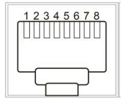

# RJ45 connector pinout

| PIN | DEFINITION |
| :-: | :------: |
|  1  |  SCL   |
|  2  |  SDA  |
|  3  |   -   |
|  4  |   -   |
|  5  |   -   |
|  6  |   -   |
|  7  |  GND  |
|  8  |  5V  |

# Throttle
## Pinout
| PIN | FUNCTION |
| :-: | :------: |
| A1  | left throttle |
| A2  | right throttle|
| B1  | button 1 |
| B0  | button 2 |
| A7  | button 3 |
| A6  | button 4 |
| A5  | button 5 |
| A4  | button 6 |
| A3  | button 7 |
| B12 | button 8 |
| B7  | SDA |
| B6  | SCL |
